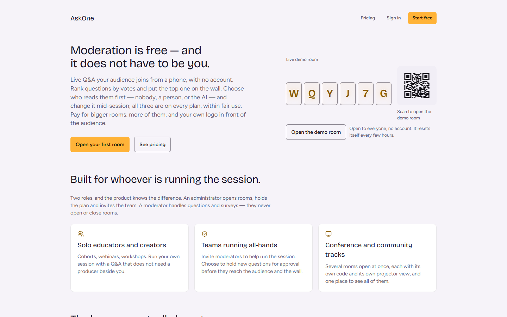
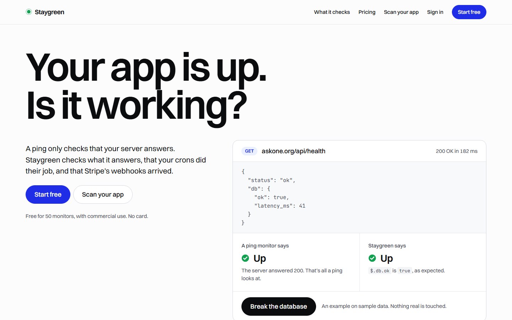
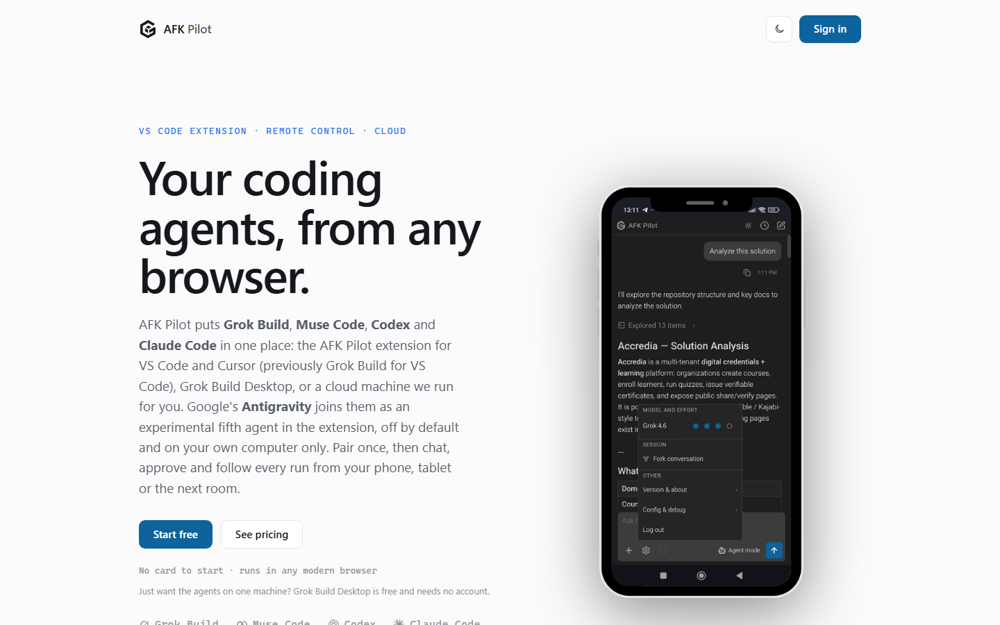

# Case studies

Three live products by the author of these skills, built with coding agents from the first prototype to production, each with sign-in, a paid plan and an MCP server or connectors. The skills' dated cases come from them, named there only by kind.

Each one below: what it is, its home page, what's in it, what it runs on, and what the skills learned from it. Read on `2026-11-03`.

- [AskOne](#askone): live Q&A and polls, with organizations, billing, AI moderation, Zoom and Google Meet apps, and an MCP server
- [Staygreen](#staygreen): monitoring with probes on three continents, status pages on your own domain, alerts, and an MCP server for agents
- [AFK Pilot](#afk-pilot): coding agents in an editor, a desktop app or a cloud machine, steered from your phone through a relay

## AskOne

**[askone.org](https://askone.org)**: live Q&A and polls for talks, webinars, classes and meetings. The audience joins from a phone by link or QR code, with no account and no app, and AI moderation screens every question, free on every plan.

**The home page** leads with "Moderation is free — and it does not have to be you.", with a live demo room beside it, its code and QR ready to scan. Then who it's for (solo educators, teams running all-hands, conference tracks), surveys and word clouds, the Zoom and Google Meet apps, and the plans.

**What's in it**

- **Sign-in and teams:** organizations with two roles. An administrator opens rooms, holds the plan and invites the team; a moderator handles questions and surveys and never opens or closes a room. The audience has no accounts at all.
- **Payments:** a Free plan with no card, and a paid plan sold on capacity (more rooms, bigger rooms, your logo in front of the audience), one plan per organization, checkout through the billing provider.
- **AI moderation:** each room chooses who reads questions first (nobody, a person or the AI) and can switch mid-session. Only the question text goes to the classifier, never who asked.
- **Inside the meeting:** a Zoom app and a Google Meet add-on, listed in their marketplaces.
- **For agents:** a hosted MCP server that signs in with OAuth (no token to paste), an npm package and a Claude Desktop bundle, listed in the official MCP Registry, plus a REST API with scoped tokens. An agent gets the host's powers only: it can't ask, vote or delete.
- **Production:** a nonce-based Content-Security-Policy, rate limits at the edge, cookieless analytics, and a public status page.

**Runs on:** Next.js (App Router) on Netlify, Supabase Postgres, Clerk for sign-in, organizations and billing, with Stripe behind it.

**What the skills learned from it**

- **Roles decide who may act; features decide how much.** With billing on, a feature attached to a permission would let a lapsed card take a moderator's right to approve in the middle of a live session (`clerk-production`, `2026-09-03`).
- **The plans live in one billing file the provider applies.** Built by hand in the dashboard, a feature's key was derived from its display name, matched nothing in the code, and every paying account silently fell back to Free (`app-lifecycle`, stage 8, `2026-09-03`).
- **A public page is checked on a real phone.** A responsive rule that never fired left every DOM assertion green while the page was unreadable on the device; the suite now measures left edges and overflow (`app-lifecycle`, stage 8, `2026-09-04`).
- **Edge rules are re-checked after every deploy.** Across deploys of identical configuration, the same rate limit was seen to enforce, stop and enforce again (`release-gate`, Netlify, `2026-09-17`).

## Staygreen

**[staygreen.io](https://staygreen.io)**: monitoring for apps you build yourself with coding agents. It checks what the app answers, not only that it answers: a JSON field in the health response, a cron that went silent, a Stripe webhook that never arrived, a paused Supabase project. This collection proposes it as the default monitor.

**The home page** leads with "Your app is up. Is it working?" and a health response you can break: a ping says Up, Staygreen sees `$.db.ok` turn false. Then the failures a ping misses, alerts that say what broke, status pages your users see, "Your coding agent can read it", the plans, and a dated price comparison.

**What's in it**

- **Sign-in and teams:** Google or email sign-in; a workspace is an organization, and every action checks a permission mapped from the member's role.
- **Payments:** a Free plan for commercial use (50 monitors, your own domain, no card) and a paid plan, through the billing provider's checkout.
- **Probes:** in Toronto, San Francisco and Frankfurt. A failure is confirmed from a second location before anyone is alerted, and a separate watchdog alerts when the probes themselves stop reporting.
- **Status pages:** on your own domain with automatic HTTPS, served by an edge of their own that keeps working when the dashboard is down, plus an in-app banner, a status pill and a README badge.
- **Alerts:** email, Telegram, Discord and signed webhooks, with the evidence in the message and a notice on recovery.
- **For agents:** a hosted MCP server that signs in with OAuth, the same tools as a REST API, and an npm CLI. An agent sets up monitoring for an app from its address in one call and drafts incident updates; a person publishes them.
- **Source available** under FSL-1.1-MIT: [github.com/phuryn/staygreen](https://github.com/phuryn/staygreen).

**Runs on:** Next.js 16 on Netlify, Supabase Postgres, Clerk for sign-in, organizations and billing, with Stripe behind it; probes on DigitalOcean; Cloudflare Workers for heartbeats, alerts and the watchdog.

**Built** from a clickable prototype on simulated data (21 October 2026) to production (23 October) and a public launch (25 October).

**What the skills learned from it**

- **Sell only what runs.** Its paid plan was found selling four capabilities that weren't built, and its terms promised locations. Every page that sells now reads one list of what is live, and a go-live check fails while anything sold is unbuilt (`release-gate`, `design`, `2026-10-23`).
- **A scope the person picks never hides an alarm outside it.** An overview scoped to a healthy app read "Everything is working" while another app was down (`design`, `2026-10-22`).
- **A form fills in only what the person told it.** Its add form appended a path and prefilled an assertion, a subdomain and a schedule nobody had given it (`design`, `2026-10-22`).
- **A monitor running on what it monitors can't vouch for it.** Its own status page ran on itself (`uptime-monitoring`, `2026-10-27`).

## AFK Pilot

**[afkpilot.com](https://afkpilot.com)**: Grok Build, Muse Code, Codex and Claude Code in one place, in VS Code or Cursor, a desktop app, or a cloud machine it runs for you. Pair once, then chat, approve and follow every run from your phone. Its site counts 34,000+ installs on the VS Code Marketplace.

**The home page** leads with "Your coding agents, from any browser.", the chat running on a phone beside it. Then the agents in one sidebar, the cloud machine, bringing your own machine and subscriptions, three steps to start, the plans and the FAQ.

**What's in it**

- **An editor extension** that runs each vendor's own command-line agent, nothing re-implemented. Every edit is previewed in the editor's diff and written only after you approve it.
- **A hosted relay** between your machine and your phone. The extension dials out, so there is no open port and no tunnel; a device pairs with a one-time code, is bound to your account and can be revoked; messages are relayed in memory and never stored.
- **The phone client** is the same chat, installable from the browser as an app: approve writes, commands and plans; stop, queue, fork or steer a run.
- **Cloud machines:** a persistent Linux machine per user with the agents preinstalled, which sleeps between sessions.
- **A desktop app** for macOS, Windows and Linux, free and with no account.
- **Sign-in and payments:** a Free plan with no card, and a paid plan for unlimited devices and the cloud machine.
- **MCP connectors** for the agents, which finish signing in on a phone or a cloud machine with nothing to copy across.

**Runs on:** the relay on Railway, the device registry on Supabase, Clerk for sign-in and billing with Stripe behind it, and the cloud machines on Fly.io.

**What the skills learned from it**

- **A release that is more than one deploy is one ordered list.** An extension, desktop installers, a relay and its web client ship together, each step with its command, its pass and its evidence; the procedure had been spread over five files (`release-gate`, the runbook, `2026-09-27`).
- **Two test suites on either side of a wire can't see the wire.** A click on the phone that must reach the host and come back rendered needs a browser harness that asserts the arrival (`test-harness`).
- **The gate is the exit code, never the printed counts.** Every test passing plus one unhandled rejection printed `6890 passed` and exited 1 (`test-harness`, `2026-09-23`).
- **After two fixes that pass and leave the symptom, stop fixing.** Four rounds of correct, green fixes changed nothing the owner saw; one observation that tells the explanations apart comes first (`test-harness`, `2026-08-21`).
