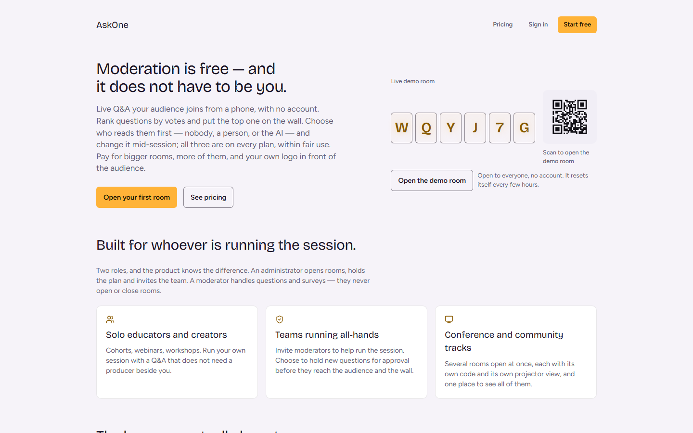
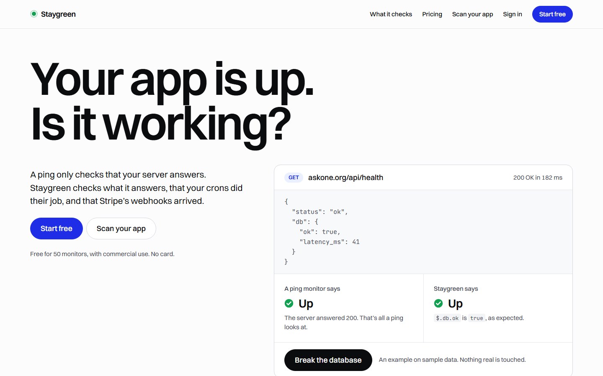
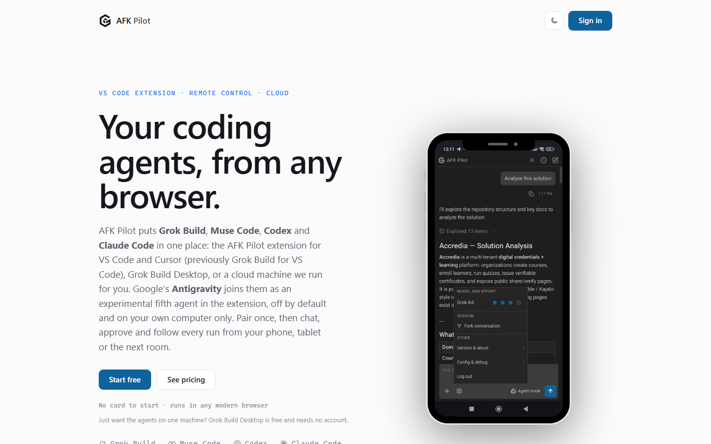

[](https://github.com/phuryn/product-engineering/blob/main/LICENSE.md)
[](https://github.com/phuryn/product-engineering/actions/workflows/tests.yml)
[](https://github.com/phuryn/pm-skills)

# Product Engineering

Agent skills for shipping real products with coding agents, from the first idea to paying users. No coding.

**Lost at any point?** Type `/product:start-here` (Codex: `$product:start-here`) and say what you have. It tells you where the work stands and what's next. [Install](#install) first.

The skills work in Claude Code, Codex, Cursor, Gemini CLI, OpenCode, GitHub Copilot and any other agent that reads `SKILL.md` folders. Free, under the MIT License, from [The Product Compass](https://www.productcompass.pm).

## Who it's for

- **Product managers, founders and designers who ship with coding agents.** You make the decisions and check the product, not every line of the code.
- **Engineers who build a product, not only the code.** That means deciding what to build, and running it in production with real users and real payments.
- **Anyone working with more than one agent**, where one session coordinates, another builds and a third reviews.

## Built with it

Three live products by the author, built with coding agents from the first prototype to production. The skills' dated cases come from them.

| [](https://askone.org) | [](https://staygreen.io) | [](https://afkpilot.com) |
|---|---|---|
| **[AskOne](https://askone.org)**: live Q&A and polls. Organizations with two roles, a paid plan, free AI moderation, Zoom and Google Meet apps, an MCP server in the official registry. | **[Staygreen](https://staygreen.io)**: monitoring that checks what your app answers. Probes on three continents, status pages on your own domain, alerts, an MCP server for agents. The default monitor here. | **[AFK Pilot](https://afkpilot.com)**: four coding agents in an editor, a desktop app or a cloud machine, steered from your phone through a relay. A paid plan, MCP connectors. |

What each one runs on, what's in it, and what the skills learned from it: [CASE-STUDIES.md](CASE-STUDIES.md).

## Install

**The quickest way:** open your agent in the project's folder and ask in the chat:

```
Please install skills from phuryn/product-engineering on GitHub in this project only. Enable auto updates.
```

In Claude Code or the Claude desktop app, that turns the six packs on for this project only (`.claude/settings.json`), updating in the background. Commit that file and everyone who opens the repository in Claude Code and trusts the folder gets them too; to keep them to yourself, ask for local scope (`.claude/settings.local.json`). The packs load in the same session (in a terminal, if `/product:start-here` isn't found, run `/reload-plugins`). Then type `/product:start-here` and say what you have.

In Codex, plugins install for your user, in every project: run the Codex commands below, start a new session, then type `$product:start-here`. If your agent can't install from a prompt, use the commands below.

**More than one agent?** Claude Code and Codex read skills from different places, so install in each one you work in. When one agent coordinates and drives the others, that one needs the skills, and a builder needs `app-stack` installed in it for screens and an MCP server, which its brief names; a reviewer starts without them on purpose.

After installing packs, apply the `agent-instructions` skill once to wire the product's entry file: owner's choices starting from skill defaults, a docs index, and router rows for installed packs — any visual work → apply `design`; a deploy-triggering push or release → apply `release-gate`; a review loop → apply `independent-review`; delegating → apply `delegation`; a lesson for the collection → type `/agent-harness:retro` (Codex: `$agent-harness:retro`). In a product that already has code, the same pass reads each installed skill whose area the code touches against that code and adds the tests those skills name that it lacks.

<details>
<summary>Install commands: Claude Code, Codex, any other agent</summary>

### Claude Code

```bash
claude plugin marketplace add phuryn/product-engineering
claude plugin install product@product-engineering
claude plugin install ai-shipping@product-engineering
claude plugin install agent-teams@product-engineering
claude plugin install agent-harness@product-engineering
claude plugin install app-stack@product-engineering
claude plugin install work-humanizer@product-engineering
```

These install for your user, in every project. Add `--scope project` to each line for this project only (`.claude/settings.json`, shared once committed), or `--scope local` for yourself here.

Then turn on updates, which third-party marketplaces don't do by default: `/plugin` → Marketplaces → `product-engineering` → enable auto-update. To update by hand: Update marketplace on the same screen, or `claude plugin update <pack>@product-engineering`.

With project-scope installs in several worktrees of one repository, check each worktree's entry in `~/.claude/plugins/installed_plugins.json` after an update (`projectPath` and `gitCommitSha`): the command may act on another worktree's record. (`2026-11-07`, a live Q&A product: with three worktrees, an update changed another worktree's record, then reported "already at the latest version" while the invoking worktree stayed on the old commit. The Claude Code version was not recorded.)

### Codex

```bash
codex plugin marketplace add phuryn/product-engineering
codex plugin add product@product-engineering   # and the other packs
```

Codex reads this repository's Claude Code marketplace as it is, and every skill runs there. The four you start run only when you name them: `$product:start-here`, `$ai-shipping:ship-check`, `$agent-harness:handover`, `$agent-harness:retro`. The rest also start themselves when you ask in plain words. To update: `codex plugin marketplace upgrade product-engineering`, then a new session.

When Claude Code hands a build to Codex, Codex reads only the packs installed in Codex, so install there what its builds need: `app-stack` for screens and an MCP server.

### Any other agent (Cursor, Gemini CLI, OpenCode, Copilot, Windsurf …)

```bash
npx skills add phuryn/product-engineering          # pick skills and agents interactively
npx skills update                             # later, to update
```

`npx skills` needs Node.js 22.20 or later; on an older Node it fails with `does not provide an export named 'glob'`. Upgrade Node, or run it through a temporary Node 22: `npx -p node@22 -p skills -c "skills add phuryn/product-engineering"`.

Or copy skill folders by hand into the folder your agent reads (`.agents/skills/`, `.claude/skills/`, `.cursor/skills/`, `~/.gemini/skills/` …). Every skill works from its own folder alone. A skill both copied and installed as a pack loads twice: keep one, and prefer the pack, which updates.

</details>

**Using [pm-skills](https://github.com/phuryn/pm-skills) too?** The two work together: pm-skills covers discovery, strategy, research, execution and go-to-market; this collection covers building, shipping and running the product with coding agents.

- **Its AI Shipping Kit moved here**, as the `ai-shipping` pack. Its skills and commands in pm-skills now only point here, so once `ai-shipping` is installed, turn off `pm-ai-shipping`. Its id is in `claude plugin list`: `pm-ai-shipping@pm-skills`, or `pm-ai-shipping@synced` when it comes from your claude.ai account (`claude plugin disable <id>`).
- **Five `product` skills are in both** (`competitor-analysis`, `market-segments`, `value-proposition`, `beachhead-segment`, `growth-loops`), updated here. pm-skills carries them beside many others, so keep those plugins; each of the five loads twice and your agent picks either copy.
- **The free `work-humanizer`**, if you installed it on its own, is the same skill as the pack here: keep one.

## From the first idea to paying users

<picture>
  <source media="(prefers-color-scheme: dark)" srcset="assets/lifecycle-dark.png">
  
</picture>

A change you can check in a minute skips to step 4. Each step with an example, from the first prompt to the next round: [WALKTHROUGH.md](WALKTHROUGH.md).

<details>
<summary>Each step in detail</summary>

| Step | You | Agents | Skills |
|---|---|---|---|
| **1. Start** | Say what you have: an idea, evidence from users, an agreed change, a bug or a release. | Read the request and the repository, and name the next step. | `start-here` |
| **2. Proposal** | Try the prototype first. Then read the proposal, answer the few questions it asks, and accept it or say what to change. | Research what you didn't share: the alternatives people use and, while it's open, the segment. Propose a direction with every claim's source, map each user job to its screen, and build a prototype on sample data that fills every screen. | `propose`, with `competitor-analysis`, `market-segments`, `beachhead-segment`, `value-proposition`, `value-curve`, `growth-loops`; `design` for the prototype's look |
| **3. Plan**, complex changes only | Review its key assumptions (how it read your ask, where it disagrees with you, what it needs you to decide), question the ones that look wrong, and say "build it". | Open with the key assumptions, then plan whatever the build needs: phases and releases, the files and modules to change, how to test it, the acceptance criteria. | `start-here` carries the prompt; `app-lifecycle` for a SaaS |
| **4. Build** | Pick when a stage offers options, such as a design direction. When the app needs accounts, keys or a domain, set them up as the agent walks you through: keys go where the agent asks, never into the chat, and production's only when it asks for them. You don't review the code line by line. | One session coordinates and another builds, and a different session reviews every change: no session reviews its own work. Tests and docs land with the change, and every fix with a test that failed before it. A fresh reviewer that never saw the build reviews every push that deploys, and again after each fix, round after round: the one your agent instructions name, or by default Grok, otherwise a fresh Claude Code session. Before the first stranger is asked for anything, the legal pages are drafted from the code for you to approve. | `delegation`, `codex-agents`, `claude-agents`, `grok-agents`, `test-harness`, `code-review`, `independent-review`, `design`, `legal-pages` |
| **5. Click-through** | Once the review is clean or running, click through the key user flows on a link: 15 to 20 minutes for a mid-size app. Click first when the question is taste or whether it's the right thing, or when you want to. | Once the reviews are clean or running, and a newcomer walkthrough, the rendered pass and a screenshot critique (with the scored audit at the first screens or a kit change) have run on every new screen, send the link, what to try (each an action and what should happen) and what isn't built yet. What you find goes back to the build and is reviewed again. No click-through when only code behind a screen changed. | `start-here`; the preview in `release-gate` |
| **6. Release review** | Pick which deeper checks run, and decide where a doc, the coverage map and the code disagree, because a doc rewritten to match faulty code blesses the bug. | Before a release, propose the deeper checks: the docs and the legal pages against the code, the coverage map, security and performance. Run the ones you pick. | `document-app` and `derive-tests` in check mode; `intended-vs-implemented`, `security-audit-static`, `performance-audit-static` |
| **7. Release** | Check what the stage promised; when a screen or its words changed, look over every screen in every state, theme, width and role, signed out included; then say go. Silence is not go. | Review everything unreleased again, round after round until one finds nothing introduced above low and nothing high or critical of any age, collect the evidence for every precondition, promote, and verify that the build serving is the one reviewed. | `release-gate` |
| **8. Real users** | Bring what people did: analytics, payments, support notes. | Run production: data, sign-in, payments, email, monitoring, and analytics that read back what people did without cookies. Weigh the new evidence against each hypothesis and propose the next round. | `product-analytics`, `environments`, `supabase-production`, `clerk-production`, `saas-authorization`, `transactional-email`, `uptime-monitoring`; `propose` |

</details>

## The skills

Most start themselves when the work matches what they're for. You start four, marked below: `/<pack>:<skill>` in Claude Code (`/product:start-here`), `$<pack>:<skill>` in Codex, `/<skill>` (Codex: `$<skill>`) from a folder copied into a repository.

**product**: Deciding what to build

- `start-here` (you start it): Where the work stands, and the next step
- `propose`: Research, then a proposal and a prototype you try
- `competitor-analysis`: Five competitors, and where to differ
- `market-segments`: Three to five segments, their jobs and pains
- `beachhead-segment`: The first segment to win
- `value-curve`: You against the alternatives, need by need
- `value-proposition`: The 6-part value proposition
- `growth-loops`: Growth loops that compound

**ai-shipping**: Shipping an AI-built app you would sign

- `ship-check` (you start it): An app without docs, to a packet you sign
- `code-review`: Correctness, plus security and performance
- `independent-review`: A fresh reviewer, round after round
- `intended-vs-implemented`: Where the code differs from what it should do
- `shipping-artifacts`: The docs that make an app reviewable
- `release-gate`: Preview, go or no-go, promote, verify
- `test-harness`: Tests where green means something
- `document-app`: System docs written from the code
- `derive-tests`: The docs turned into a test-coverage map
- `security-audit-static`: Security risks backed by evidence
- `performance-audit-static`: N+1 queries, over-fetching, missing indexes

**agent-teams**: Other agents as partners

- `delegation`: The brief, and what never delegates
- `codex-agents`: Codex as a peer, builder or reviewer
- `grok-agents`: Grok as a peer, builder or reviewer
- `claude-agents`: Claude Code as a peer, builder or reviewer

**agent-harness**: A reliable agent setup, with you in the loop

- `handover` (you start it): The note the next session starts from
- `retro` (you start it): A session's learnings, built into your setup
- `agent-instructions`: The AGENTS.md or CLAUDE.md every session reads
- `guardrail-hooks`: Rules turned into hooks
- `flight-deck`: A status board that survives compaction
- `windows-agent-shell`: The Windows traps that break agents

**app-stack**: A SaaS on Next.js, Supabase, Clerk and Netlify

- `app-lifecycle`: Idea to production, stage by stage
- `saas-authorization`: Who may do what, per workspace
- `supabase-production`: The production database
- `clerk-production`: Sign-in, organizations and billing
- `environments`: Development and production kept apart
- `design`: Every screen from a user's job, then designed, built and judged
- `transactional-email`: Email with receipts and one-click unsubscribe
- `legal-pages`: Terms, privacy policy and consent that match the code
- `product-analytics`: Cookieless recordings and heatmaps your agents read back
- `uptime-monitoring`: Knowing it's down before users do; Staygreen, made by the author, by default
- `mcp-server`: A remote MCP server, right the first time
- `chatgpt-plugin`: Through OpenAI's plugin review
- `embedded-agents-messages-api`: Claude agents in your app, on the API
- `embedded-agents-agent-sdk`: The same, on the Agent SDK

**work-humanizer**: Work writing that doesn't read as AI

- `work-humanizer`: Edits AI-sounding text, or interviews you

28 of the 44 skills were learned on real products built with Claude Code, Codex and Grok; 14 are established methods (the strategy frameworks in `product`, the documentation and review methods in `ai-shipping`); `product-analytics` rests on its vendors' docs and `work-humanizer` on a detector test. Each pack's `README.md` says more about every skill.

<details>
<summary>What the skills cost your agent</summary>

Your agent always carries the descriptions of the 40 skills that start themselves: about 6,000 characters, about 2,600 tokens in Claude Code. A skill's full text loads only when it runs. `tools/validate.py` holds the descriptions to 6,000 characters in total and 300 each, because a crowded agent setup cuts descriptions short, and the cut falls on the words that say when to use a skill.

</details>

## How it works

- **Evidence before the build.** The agent reads what you shared and researches what's missing: alternatives, the market, what people say. It proposes informed hypotheses, each with its source, and asks only what the evidence can't decide.
- **You decide on what you can see.** The proposal comes with a prototype on sample data, and the build reads the proposal you accepted. While agents work, what waits on you is on one page, each item with a recommendation. Once it's built and reviewed, you click through it; before a release, agents propose deeper checks of the docs, the tests and the code, and you pick what runs.
- **Building is the experiment.** Building is cheap now, and use beats intent. Build the first version with payment in days, put it in front of real users, and go round again with what they did. What people see comes first, because it's cheap: the landing, pricing and legal pages with the first screens, hard logic once the product is worth it.
- **Production is part of the method.** Nobody pays until payment works in production. The release gate, environments, authorization, billing, email and monitoring are in the collection, not left for later.
- **The session that wrote the code never clears it.** Before every push that deploys, and again before a release, a fresh reviewer that never saw the build reads the change, round after round, until one finds nothing the change introduced above low severity and nothing high or critical of any age. By default it's Grok, another model family, otherwise a fresh Claude Code session with nothing carried over. A line in your agent instructions names another, Codex included, if it can run the way `independent-review` requires: read-only, no MCP servers, its memory off.
- **No ceremony for small work.** A change you can check in a minute goes straight to the build and its check. Only a complex change gets a plan, and the agent writes it.

The process is the one in the [Product Engineering for PMs](https://www.productcompass.pm/p/product-engineering-for-pms) series, which builds a real SaaS app with it, step by step.

## How it differs from collections written for engineers

Collections written for engineers who own their code do what they are for well: test-first code, in a vocabulary you review line by line. This one starts from a different place and checks a different thing.

| | Written for engineers | Product Engineering |
|---|---|---|
| **Starts from** | Your idea, sharpened by an interview | Evidence: research on the alternatives and the segment, then a proposal with every claim's source |
| **Questions** | About your idea; no market research | A few, after the research, each with a recommended answer |
| **The spec** | A document, then tasks or tickets | The proposal you decide on, with a prototype you click; no tickets |
| **You check** | The code, line by line | Your decisions, in the proposal, the plan and one page of what waits on you; the release's evidence; and the product, clicking through every change you can see |
| **Tests** | Written first | Land with the change; every fix with a test that failed before it |
| **Reviewed by** | The session that wrote the code, or its subagents | A fresh reviewer that never saw the build: Grok by default, another model family, or one you name |
| **Ends at** | The pull request, sometimes the deploy | Paying users: legal pages, sign-in, payments, email, analytics and monitoring in production, through a release you say go to; then the next round |

Three things can go wrong in any skill collection, and this one guards against them:
- **Decisions get lost** between documents, and decision records pile up and go stale. Here there is one proposal, which the build reads, its recommendation rewritten, never appended to; for a SaaS, choices with real options go in one decision log (`app-lifecycle`), each with the trigger that reopens it.
- **Skills fail to load what they depend on.** Every skill works from its own folder, and a validator checks every skill and every file a skill names.
- **Rules read as common sense, with nothing behind them.** A rule learned in practice keeps its receipt, the date and what broke or was measured, about 700 of them; a new one needs an observed failure.

## Scripts

Some skills ship scripts — the Codex wrapper, the review wrapper, the Claude wrapper, hook templates. They need Python 3.9+ (standard library, except where a skill says otherwise) and the CLI they drive. Each skill says which. Nothing runs unless your agent runs it.

## More techniques

For additional discovery, prioritization, experimentation and go-to-market techniques, see the free [PM Skills collection](https://github.com/phuryn/pm-skills).

## Updates and feedback

Skills change as the agents and platforms do; every platform fact inside is dated. What changed is in each commit. Requests the collection decided not to take, and why, are in [rejected.md](rejected.md). Questions and reports: [open an issue](https://github.com/phuryn/product-engineering/issues).

## License

MIT: see [LICENSE.md](LICENSE.md).
